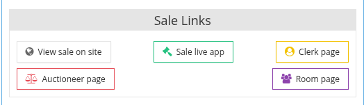
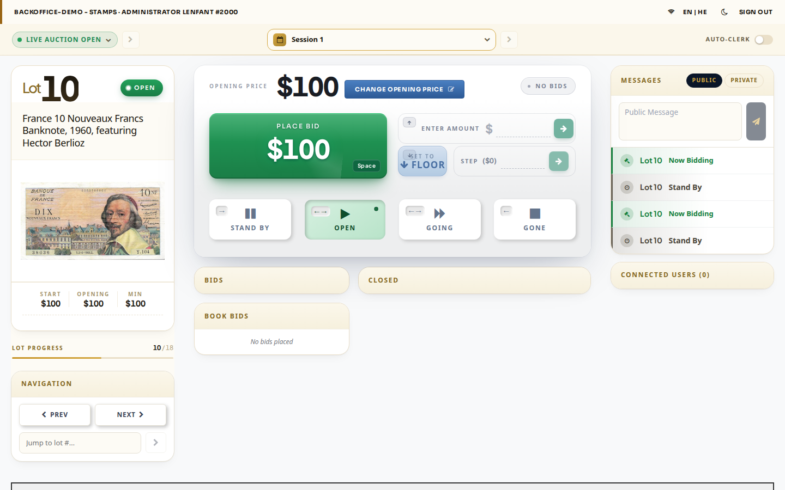

<!-- i18n source=auction/clerk-screen/README.md sha=1df0eae6e33d -->
# Der Clerk-Bildschirm

Der Clerk-Bildschirm ist die Seite der Live-App, von der aus der Protokollführer die Auktion steuert: Er legt Auktionsstatus und Sitzung fest, öffnet und schließt jedes Los und erfasst die Gebote aus dem Saal.

## Den Clerk-Bildschirm öffnen

1. Öffnen Sie im Backoffice die Auktion (**Auktionen**, dann auf die Auktion klicken).
2. Suchen Sie auf dem Reiter **Auktion** den Block **Auktionslinks** und klicken Sie auf **Protokollführer-Seite**. Der Clerk-Bildschirm öffnet sich in einem neuen Browser-Tab.

Die Links zur Live-App erscheinen nur, wenn die Auktion mit dem Bid-Server synchronisiert ist. Derselbe Block öffnet auch die **Live-App der Auktion** (die Ansicht der Bieter), die **Auktionator-Seite** und die **Saal-Seite**.

## Die Bereiche des Bildschirms

| Bereich | Wofür er dient |
| :--- | :--- |
| **Status** \(oben links\) | Der Auktionsstatus, zum Beispiel *Live auction open*. Wählen Sie einen Status und klicken Sie auf den Pfeil, um ihn anzuwenden. Siehe [Auktionsstatus festlegen](/de/auction/clerk-screen/how-to-set-the-action-status.md). |
| **Session** \(oben Mitte\) | Die Sitzung, die gerade versteigert wird. Siehe [Auktionssession festlegen](/de/auction/clerk-screen/how-to-set-the-action-session-and-status.md). |
| **Auto-clerk** \(oben rechts\) | Schaltet die automatische Protokollführung ein oder aus. |
| **Los-Karte** \(links\) | Das aktuelle Los: Nummer, Zustand, Beschreibung, Bild sowie Start-, Eröffnungs- und Mindestpreis. **Lot progress** zeigt, wie weit die Sitzung fortgeschritten ist. |
| **Navigation** \(unten links\) | **Prev**, **Next** und **Jump to lot** wechseln zu einem anderen Los. Siehe [Los zum Bieten auswählen](/de/auction/clerk-screen/how-to-select-the-bidding-item.md). |
| **Gebotsbereich** \(Mitte\) | Der Eröffnungs- oder aktuelle Preis, **Place bid**, **Enter amount**, **Set to floor** und **Step**. Siehe [Gebot aus dem Saal abgeben](/de/auction/clerk-screen/how-to-place-a-bid-from-the-room.md). |
| **Stand by / Open / Going / Gone** | Der Zustand des aktuellen Loses. Siehe [Auktionsablauf](/de/auction/auction-flow.md). |
| **Bids**, **Book bids**, **Closed** | Die Gebote auf das aktuelle Los, die dafür vorliegenden schriftlichen Gebote und die bereits geschlossenen Lose. |
| **Messages** \(rechts\) | Der Verlauf der Ereignisse in der Auktion und ein Feld, um eine öffentliche oder private Nachricht an die Bieter zu senden. |
| **Connected users** | Die Bieter, die gerade mit der Live-Auktion verbunden sind. |
