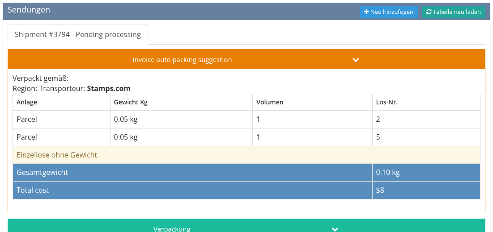

<!-- i18n source=shipping/README.md sha=79db5b72c879 -->
# Versand

Lieber zuschauen? Sieben kurze Videos zeigen den ganzen Ablauf: [Tutorials: Versand](/de/tutorials/shipping.md).

Der Versand umfasst alles, was mit einer Käuferrechnung geschieht, sobald die Lose das Haus verlassen: Versanddienstleister und Preis wählen, das Versandetikett kaufen, die Lose in Kartons verpacken und das Paket bis zur Zustellung verfolgen.

## Wo Sie ihn finden

* **In einer Rechnung:** Öffnen Sie die Rechnung und klicken Sie auf den Reiter **Versand / Verpackung**. Alles zu den Paketen dieser Rechnung geschieht hier.
* **Über alle Rechnungen:** Die Seite **Sendungen** im Hauptmenü listet alle Sendungen, mit Filtern, Etikettendruck und Rücksendeetiketten. Siehe [Die Seite Sendungen](/de/shipping/shipments-page.md).
* **Einstellungen:** Versandanbieter, Versicherung, Bearbeitungsaufschlag und Absenderadresse legt ein Administrator fest. Siehe [Versandeinstellungen](/de/shipping/shipping-settings.md).

## Grundbegriffe

| Begriff | Bedeutung |
| :--- | :--- |
| **Sendung** | Ein Paket (oder eine Gruppe von Kartons, die zusammen verschickt werden) für eine Rechnung. Eine Rechnung kann mehrere Sendungen haben, und eine Sendung kann die Lose mehrerer Rechnungen desselben Käufers enthalten. |
| **Versandanbieter** | Woher die Preise kommen. Mit **ShipStation** fragt das System die Versanddienstleister nach aktuellen Tarifen und kauft echte Versandetiketten. Mit dem Anbieter **Manual** kommt der Preis aus Ihren eigenen Tariftabellen, und es wird kein Etikett gekauft. |
| **Tarif** | Ein Service eines Versanddienstleisters mit Preis und voraussichtlicher Lieferzeit, zum Beispiel *UPS Ground*. Pro Sendung wählen Sie einen Tarif. |
| **Etikett** | Das für eine Sendung gekaufte Versandetikett. Sobald ein Etikett gekauft ist, sind Inhalt und Preis der Sendung gesperrt, bis Sie das Etikett stornieren. |
| **Berechneter Gesamtbetrag** (*Total billed*) | Was der Käufer für die Sendung zahlt: die Kosten des Versanddienstleisters plus Versicherung, Bearbeitungsaufschlag und Zuschläge, gerundet. Er wird der Rechnung als eine **Versand**-Gebühr hinzugefügt. |
| **Lieferstatus** | Wo das Paket ist: *Pending processing*, *To pack*, *Packed*, *Out of the door*, *Received* oder *Error*. |

## Der übliche Ablauf

1. [Sendung erstellen](/de/shipping/create-a-shipment.md): Adresse wählen, Tarife abrufen und einen Versanddienstleister auswählen.
2. Speichern und [das Etikett kaufen](/de/shipping/labels-and-tracking.md), sofort oder später.
3. [Die Lose verpacken](/de/shipping/packing.md): jedes Los als verpackt markieren oder scannen. Die Sendung wechselt auf *Packed*, wenn das letzte Los verpackt ist.
4. Das Paket dem Versanddienstleister übergeben und [die Sendungsverfolgung beobachten](/de/shipping/labels-and-tracking.md#sendungsverfolgung-und-lieferstatus), bis es *Received* ist.

Hat ein Käufer mehrere Rechnungen oder muss eine Rechnung in mehreren Paketen verschickt werden, siehe [Zusammengefasste und aufgeteilte Sendungen](/de/shipping/combined-and-split-shipments.md).
