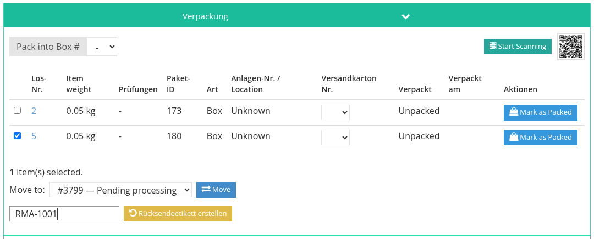

<!-- i18n source=shipping/combined-and-split-shipments.md sha=c6332c3e8a86 -->
# Zusammengefasste und aufgeteilte Sendungen

## Mehrere Rechnungen in einem Paket

Hat derselbe Käufer mehr als eine Rechnung in derselben Auktion, können seine Lose in einem Paket verschickt werden.

**Bevor die Sendung gespeichert ist:** Im Reiter **Versand / Verpackung** zeigt der Packvorschlag die anderen Rechnungen des Käufers, die zusammengefasst werden können. Klicken Sie auf **Click here to combine the shipment.** Gewicht, Tarife und Gesamtbetrag werden für alle Lose zusammen neu berechnet. Speichern Sie wie gewohnt.

**Nachdem die Sendung gespeichert ist:** Kommt eine weitere Rechnung desselben Käufers hinzu, zeigt die gespeicherte Sendung sie mit **Click here to attach to this shipment.** an. Ihre Lose werden hinzugefügt und das Gewicht neu berechnet. Solange die Sendung ein Etikett hat, ist das nicht möglich: Stornieren Sie zuerst das Etikett.

Eine zusammengefasste Sendung zeigt in der Packtabelle eine Spalte **Rechnung**, sodass Sie sehen, aus welcher Rechnung jedes Los stammt. Die anderen Rechnungen zeigen einen Hinweis auf die Sendung, die ihre Lose enthält.

Zusammenfassen lassen sich nur Rechnungen desselben Käufers in derselben Auktion, die noch keine eigene Sendung haben.

## Eine Rechnung auf mehrere Pakete aufteilen

Video: [Sendung aufteilen](/de/tutorials/shipping.md#_5-sendung-aufteilen).

1. Speichern Sie die erste Sendung. Alle Lose der Rechnung sind ihr zugeordnet.
2. Klicken Sie auf **Neu hinzufügen** und speichern Sie eine zweite Sendung. Sie beginnt leer.
3. Haken Sie in der Packtabelle der ersten Sendung die Lose für das zweite Paket an, wählen Sie unter **Move to** die Zielsendung und klicken Sie auf **Move**.

Das Gewicht beider Sendungen wird neu berechnet. Solange eine der beiden Sendungen ein Etikett hat, lassen sich keine Lose verschieben.

Die Versicherung wird auf die tatsächlich im jeweiligen Paket enthaltenen Lose berechnet, sodass bei einer aufgeteilten Rechnung jedes Paket die Obergrenze der Versicherungsgebühr erreichen kann.

Siehe auch [Sendung erstellen](/de/shipping/create-a-shipment.md) und [Verpacken](/de/shipping/packing.md).
