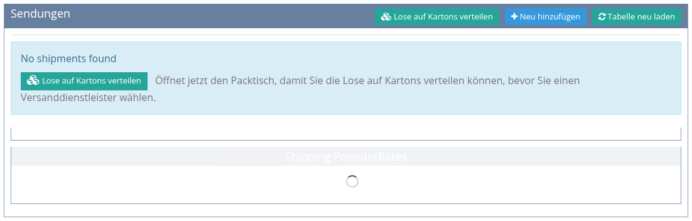
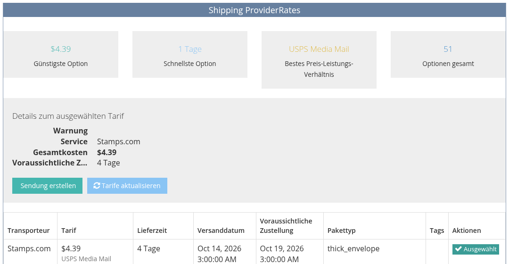
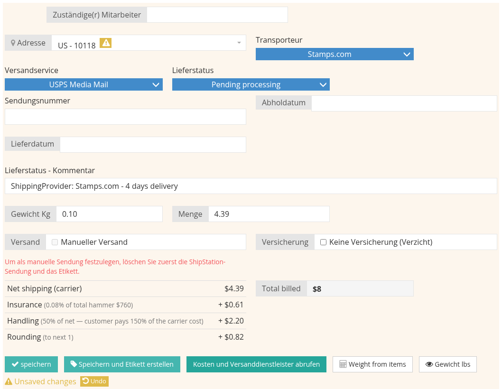

<!-- i18n source=shipping/create-a-shipment.md sha=108c92412e8c -->
# Sendung erstellen

Eine Sendung wird im Reiter **Versand / Verpackung** der Rechnung erstellt. Video: [Sendung erstellen](/de/tutorials/shipping.md#_1-sendung-erstellen).

## Bevor Sie beginnen

Oben im Reiter zeigt **Versandeinstellungen** die Versandvorgaben des Käufers aus der Kundenseite, zum Beispiel sein Kundenkonto beim Versanddienstleister oder einen bevorzugten Versanddienstleister und Service. Hat der Kunde einen bevorzugten Versanddienstleister oder Service, werden nur dessen Tarife angeboten.

Liegt die Rechnung über dem Schwellenwert für die Zahlungsfreigabe, erscheint eine Meldung **Payment Approval Required**, und der Versand ist gesperrt, bis die Zahlung freigegeben ist.

## Die Sendung erstellen

1. Öffnen Sie die Rechnung und klicken Sie auf den Reiter **Versand / Verpackung**.
2. Klicken Sie im Block **Sendungen** auf **Neu hinzufügen**. Ein neuer Reiter **Shipment #New** öffnet sich mit dem Sendungsformular und dem **Invoice auto packing suggestion**: wie die Lose verpackt würden und das Gesamtgewicht.

   

3. Prüfen Sie die **Adresse**. Vorgegeben ist die Standardadresse des Käufers; wählen Sie bei Bedarf eine andere seiner Adressen.
4. Prüfen Sie das **Gewicht**. Es wird aus den Losen berechnet. Klicken Sie auf **Weight from items**, um es neu zu berechnen, oder auf **Gewicht lbs**, um es in Pfund zu sehen.
5. Klicken Sie auf **Kosten und Versanddienstleister abrufen**. Die Tariftabelle listet die Services, die das Paket zustellen können, mit Preis und voraussichtlicher Lieferzeit. Die günstigste, die schnellste Option und das beste Preis-Leistungs-Verhältnis sind hervorgehoben.

   

6. Klicken Sie beim gewünschten Tarif auf **Auswählen**. Die Felder **Transporteur**, **Versandservice**, **Menge** (der Betrag) und **Total billed** werden ausgefüllt.
7. Speichern:
   * **Speichern** legt die Sendung an, ohne ein Etikett zu kaufen. Sie können es später mit **Versandetikett erstellen** kaufen.
   * **Speichern und Etikett erstellen** legt die Sendung an und kauft das Versandetikett in einem Schritt.

Der **Total billed** der Sendung wird der Rechnung als **Versand**-Gebühr hinzugefügt. Speichern Sie die Rechnung, nachdem eine neue Gebühr hinzugefügt wurde.

## Optionen im Formular

| Option | Wirkung |
| :--- | :--- |
| **Manueller Versand** | Legt die Sendung ohne ShipStation an: Es wird kein Tarif übermittelt und kein Etikett gekauft. Für Pakete, die Sie anders verschicken. Den Betrag tragen Sie selbst ein. |
| **Kostenloser Versand** | Fügt die Versandgebühr und einen gleich hohen Rabatt hinzu, sodass der Käufer für den Versand nichts zahlt. |
| **Keine Versicherung (Verzicht)** | Berechnet die Sendung ohne Versicherung: Nur die Versandkosten werden berechnet. |
| **Zuständige(r) Mitarbeiter** | Die Mitarbeiter, die für dieses Paket zuständig sind. |
| **Lieferstatus**, **Sendungsnummer**, **Abholdatum**, **Lieferdatum** | Werden automatisch ausgefüllt, wenn ein Etikett gekauft wird und Tracking-Daten eintreffen; Sie können sie auch von Hand setzen. |

## So wird der Gesamtbetrag berechnet

**Total billed** = Kosten des Versanddienstleisters + Versicherung + Verpackungs- und Bearbeitungsaufschlag + Zuschläge des Versanddienstleisters, dann gerundet. Der Käufer sieht eine **Versand**-Zeile auf der Rechnung; die Versicherung wird nicht getrennt ausgewiesen. Die Prozentsätze legt ein Administrator fest, siehe [Versandeinstellungen](/de/shipping/shipping-settings.md).

## Keine Tarife?

Meldet die Tariftabelle, dass für dieses Ziel keine Tarife verfügbar sind, prüfen Sie, ob die Adresse vollständig ist (Straße, Ort, Postleitzahl und Land) und das Gewicht nicht null ist.

Siehe auch [Etiketten und Sendungsverfolgung](/de/shipping/labels-and-tracking.md) und [Verpacken](/de/shipping/packing.md).
