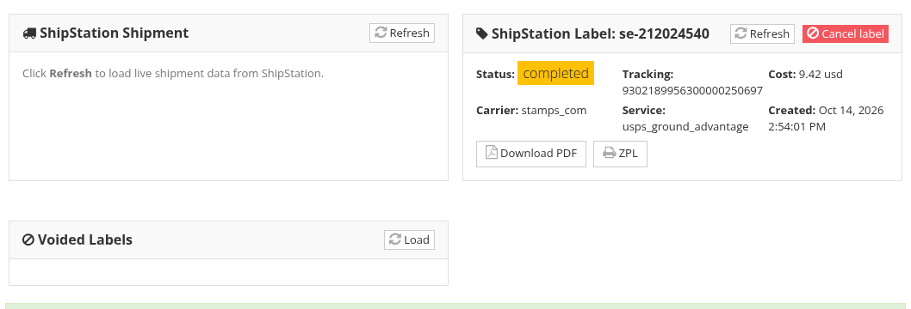

<!-- i18n source=shipping/labels-and-tracking.md sha=cd849aac5eab -->
# Etiketten und Sendungsverfolgung

Mit dem Anbieter ShipStation kauft das System das Versandetikett für Sie und verfolgt das Paket über die Sendungsverfolgung des Versanddienstleisters. Videos: [Versandetiketten](/de/tutorials/shipping.md#_2-versandetiketten) und [Sendungsverfolgung und Rücksendungen](/de/tutorials/shipping.md#_6-sendungsverfolgung-und-rücksendungen).

## Das Etikett kaufen

* Klicken Sie beim Erstellen der Sendung auf **Speichern und Etikett erstellen**, oder
* klicken Sie bei einer gespeicherten Sendung ohne Etikett auf **Versandetikett erstellen**.

Ein Bereich **ShipStation Label** zeigt dann das Etikett: Status, Sendungsnummer, Kosten, Versanddienstleister und Service. Klicken Sie auf **Download PDF**, um es zu drucken, oder auf **ZPL** für einen Thermo-Etikettendrucker. Die Sendungsnummer wird auch in der Sendung eingetragen, mit einem Link **Download label PDF** daneben.

Eine Sendung mit mehreren Kartons (ihre Lose sind auf mehrere Kartons verteilt, siehe [Verpacken](/de/shipping/packing.md)) geht als ein Paket pro Karton an den Versanddienstleister, sodass jeder Karton ein eigenes Etikett bekommt. Wählen Sie einen Versanddienstleister, der mehrere Pakete in einer Sendung annimmt, etwa UPS oder FedEx: USPS (Stamps.com) tut das nicht.

## Ein Etikett sperrt die Sendung

Sobald ein Etikett gekauft ist, darf sich das Paket, das der Versanddienstleister kennt, nicht mehr ändern. Solange das Etikett existiert, können Sie nicht:

* Gewicht oder Betrag ändern,
* einen anderen Tarif wählen,
* Lose in eine andere Sendung oder einen anderen Karton verschieben,
* die Lose einer anderen Rechnung zur Sendung hinzufügen.

Um etwas davon zu ändern, klicken Sie zuerst im Bereich **ShipStation Label** auf **Cancel label** und bestätigen. Das Etikett wird beim Versanddienstleister storniert und die Sendung freigegeben. Nehmen Sie Ihre Änderungen vor, rufen Sie die Tarife erneut ab und kaufen Sie ein neues Etikett.

Stornierte Etiketten bleiben gespeichert: Klicken Sie im Bereich **Voided Labels** auf **Load**, um sie anzuzeigen.

## Die Sendung aktualisieren

Ändern Sie die Adresse oder das Gewicht einer Sendung, die bereits an ShipStation übermittelt wurde (bevor ein Etikett gekauft ist), klicken Sie auf **Sendung aktualisieren**, um die Änderung zu senden.

## Sendungsverfolgung und Lieferstatus

Sobald der Versanddienstleister das Paket hat, kommen Tracking-Meldungen automatisch und füllen:

* den **Lieferstatus** (zum Beispiel *Out of the door*, dann *Received*),
* das **Abholdatum** und das **Lieferdatum** (das tatsächliche Zustelldatum),
* das voraussichtliche Lieferdatum des Versanddienstleisters und seine Meldungen in **Lieferstatus - Kommentar**.

Klicken Sie auf **Sendungsverfolgung aktualisieren**, um den neuesten Stand sofort abzurufen.

Ein Paket, das sein voraussichtliches Lieferdatum überschritten hat und nicht angekommen ist, wird auf der [Seite Sendungen](/de/shipping/shipments-page.md) als überfällig markiert und kann eine Aufgabe auslösen (siehe [Versandeinstellungen](/de/shipping/shipping-settings.md)).

## Rücksendeetiketten

Schickt der Käufer Lose zurück, erstellen Sie ein Rücksendeetikett aus der ursprünglichen Sendung:

1. Haken Sie in der Packtabelle der Sendung die zurückkommenden Lose an (das Kästchen am Anfang jeder Zeile).
2. Geben Sie die **RMA-Nummer** ein, falls Sie eine haben.
3. Klicken Sie auf **Rücksendeetikett erstellen**.

Für diese Lose wird eine Rücksendung mit eigenem Versandetikett angelegt. Sie erscheint mit ihrer RMA-Nummer in der ursprünglichen Sendung: Laden Sie das Etikett dort herunter und schicken Sie es dem Käufer. Rücksendeetiketten hängen vom Versanddienstleister ab: Nicht jeder nimmt sie an.

Siehe auch [Sendung erstellen](/de/shipping/create-a-shipment.md) und [Die Seite Sendungen](/de/shipping/shipments-page.md).
