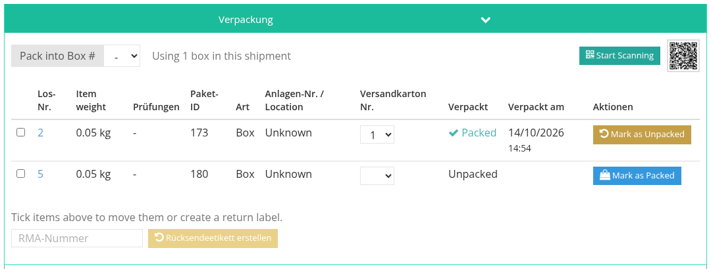
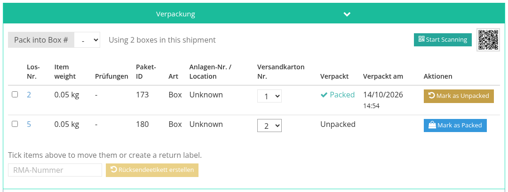
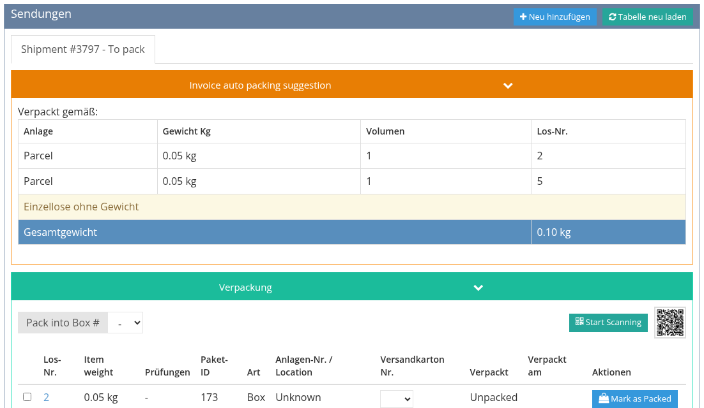

<!-- i18n source=shipping/packing.md sha=234db396bc2f -->
# Verpacken

Jede Sendung hat eine Packtabelle mit ihren Losen. Das Verpacken hält fest, welches Los in welchen Karton kam, und bringt den Lieferstatus der Sendung voran. Videos: [Verpacken](/de/tutorials/shipping.md#_3-verpacken) und [Erst verpacken, dann berechnen](/de/tutorials/shipping.md#_4-erst-verpacken-dann-berechnen).

## Die Packtabelle

Unter dem Sendungsformular zeigt die Packtabelle eine Zeile pro Los oder Paket, mit **Lot #**, Losgewicht, **Package ID**, dem Lagerort (**Box number / Location**), dem **Versandkarton Nr.**, in den es verpackt ist, sowie ob und wann es verpackt wurde.

Lose **unter Verlängerung** (der Käufer hat ein Gutachten angefragt, das noch aussteht) sind mit einer Sanduhr markiert. Sie können nicht verpackt werden, und ihr Paket bekommt kein Etikett, bis die Verlängerung beantwortet ist. Über einen Bestätigungsdialog können Sie trotzdem fortfahren; die Ausnahme wird in der Rechnung vermerkt.

## Die Lose verpacken

Verpacken ist möglich, solange der **Lieferstatus** der Sendung **To pack** (oder **Packed**) ist. Setzen Sie ihn im Sendungsformular auf **To pack** und speichern Sie. Klicken Sie dann für jedes Los auf **Mark as Packed** (oder **Create Package & Pack**, wenn das Los noch kein Paket hat). Mit **Mark as Unpacked** machen Sie es rückgängig.

* Ist das letzte Los verpackt, wechselt die Sendung von selbst auf **Packed**.
* Wird ein Los wieder ausgepackt, geht die Sendung zurück auf **To pack**.

## Scannen statt klicken

Klicken Sie auf **Start Scanning**, um durch Scannen der Barcodes der Lose zu verpacken, oder scannen Sie den QR-Code daneben mit dem Handy, um diese Sendung auf dem Handy zu öffnen und dort zu scannen. Klicken Sie zum Abschluss auf **Stop Scanning**.

## Mehrere Kartons

Um die Lose auf mehrere Kartons zu verteilen, wählen Sie für jedes Los die Kartonnummer in der Spalte **Versandkarton Nr.** (oder wählen Sie vor dem Verpacken einen Karton unter **Pack into Box #**). Die Tabelle zeigt, wie viele Kartons verwendet werden (*Using 2 boxes in this shipment*), und das Sendungsformular zeigt **Dies ist eine Sendung mit mehreren Kartons**. Jeder Karton geht als eigenes Paket an den Versanddienstleister. Wählen Sie also einen, der mehrere Pakete in einer Sendung annimmt, etwa UPS oder FedEx. USPS (Stamps.com) tut das nicht.

### Vor der Wahl des Versanddienstleisters verpacken

Oft wissen Sie, wie die Lose in die Kartons passen, bevor Sie wissen, was der Versanddienstleister verlangt. Klicken Sie bei einer Rechnung ohne Sendung auf **Lose auf Kartons verteilen**: Die Packtabelle öffnet sich sofort, noch ohne Versanddienstleister. Ordnen Sie die Kartons zu und klicken Sie dann auf **Kosten und Versanddienstleister abrufen**, um Preise für die echten Kartons zu erhalten.

Wird ein Los einer Rechnung ohne Sendung verpackt, wird ebenfalls automatisch eine Entwurfssendung angelegt, bereits auf **To pack** gesetzt.

Siehe auch [Sendung erstellen](/de/shipping/create-a-shipment.md) und [Zusammengefasste und aufgeteilte Sendungen](/de/shipping/combined-and-split-shipments.md).
