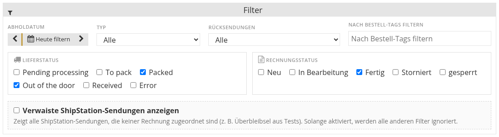
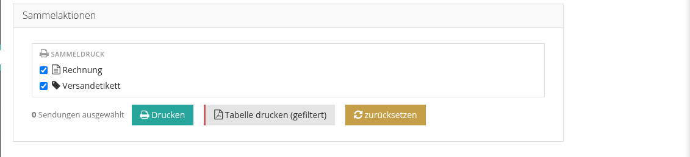
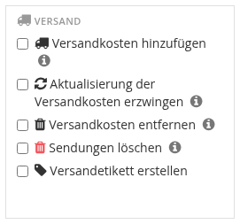

<!-- i18n source=shipping/shipments-page.md sha=00c4aad37bc8 -->
# Die Seite Sendungen

Die Seite **Sendungen** (Hauptmenü) listet die Sendungen aller Rechnungen, mit Versanddienstleister, Etikett, Sendungsverfolgung und Lieferstatus. Video: [Die Seite Sendungen](/de/tutorials/shipping.md#_7-die-seite-sendungen).

## Filtern

Filtern Sie die Tabelle nach **Lieferstatus**, **Rechnungsstatus**, **Typ**, Bestell-Tags, Gewichtsbereich und **Abholdatum** (mit **Heute filtern** und den Pfeilen, um einen Tag vor oder zurück zu gehen). Der Filter **Rücksendungen** zeigt nur Rücksendeetiketten oder blendet sie aus. **Zurücksetzen** löscht die Filter.

**Verwaiste ShipStation-Sendungen anzeigen** listet Sendungen, die in ShipStation existieren, aber keiner Rechnung zugeordnet sind, zum Beispiel Überbleibsel von Tests.

Eine Sendung, die ihr voraussichtliches Lieferdatum überschritten hat und nicht angekommen ist, wird als überfällig markiert.

## Drucken

* **Tabelle drucken (gefiltert)** druckt die Liste so, wie sie gefiltert ist.
* Wählen Sie Sendungen aus und nutzen Sie **Sammelaktionen → Sammeldruck**, um ihre Etiketten zusammen zu drucken.
* Jede Zeile verlinkt auf ihre Rechnung und ihr Etikett-PDF.

## Sammelversand aus der Rechnungsliste

In der Liste der Käuferrechnungen können Sie den Versand vieler Rechnungen auf einmal bearbeiten. Haken Sie die Rechnungen an, öffnen Sie die **Sammelaktionen** und wählen Sie im Kasten **Versand**:

| Aktion | Wirkung |
| :--- | :--- |
| **Versandkosten hinzufügen** | Legt eine Sendung an und fügt jeder Rechnung die Versandgebühr hinzu. |
| **Aktualisierung der Versandkosten erzwingen** | Berechnet die Versandkosten neu und überschreibt die bestehende Gebühr. |
| **Versandkosten entfernen** | Entfernt die Versandgebühr aus der Rechnung; die Sendung bleibt erhalten. |
| **Sendungen löschen** | Löscht alle Sendungen der Rechnung: storniert die Versandetiketten und löst die Lose. |
| **Versandetikett erstellen** | Kauft das Versandetikett für die Sendung jeder Rechnung. |

Große Stapel laufen im Hintergrund. Rechnungen mit Losen unter Verlängerung werden übersprungen und markiert.

Siehe auch [Etiketten und Sendungsverfolgung](/de/shipping/labels-and-tracking.md).
