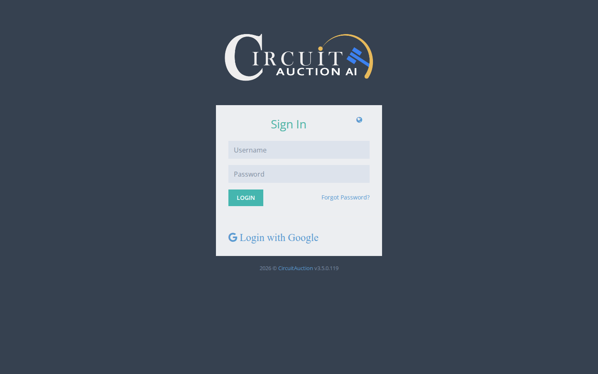
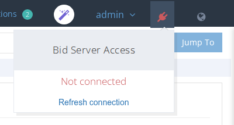

# Logging into the System

This one-minute video shows the login, the Bid Server connection check and how to choose the sale you work on. The steps are also described below.

<video class="release-video" controls preload="metadata" playsinline src="https://circuit-kubernetes.s3.eu-central-1.amazonaws.com/openmontage/tutorials/getting-started-logging-in/final.mp4">Your browser does not support the video tag. <a href="https://circuit-kubernetes.s3.eu-central-1.amazonaws.com/openmontage/tutorials/getting-started-logging-in/final.mp4">Download the video</a>.</video>

Open the web browser \(the latest version of Chrome is recommended\) and enter the system URL.

Log in with your Username and Password.

If your account is protected with two-factor authentication, a **Code** field also asks for the current code from your authenticator app. See [Logging in with an Authenticator App](logging-in-with-an-authenticator-app.md).

Make sure the Bid Server Connection icon is green. This means that the data is synchronized correctly with the Bid system. 

If the icon is red, click on it and then click on **Refresh connection**.

When logged in, you will see the main dashboard and the sidebar menu. This allows you to navigate through the system functions.

## Choose your sale

Before you start working, select the sale in the **Sale context** field at the top of the screen. Items and Bids then show only the items and bids of that sale. Clients always show the full list: the sale context does not filter them.

See [Sale Context](sale/sale-context.md) for the details.
