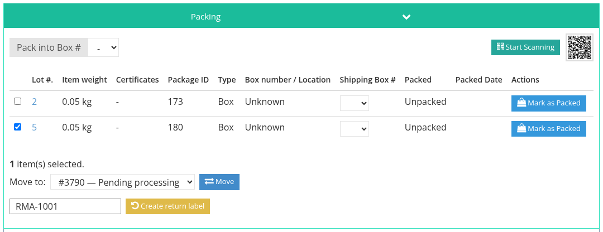

# Combined and Split Shipments

## Combine several invoices in one parcel

When the same buyer has more than one invoice in the same sale, their lots can travel in one parcel.

**Before the shipment is saved:** on the **Shipping & Packing** tab, the packing suggestion shows the buyer's other invoices that can be combined. Click **Click here to combine the shipment.** The weight, rates and total are recalculated for all the lots together. Save as usual.

**After the shipment is saved:** when another invoice of the same buyer arrives, the saved shipment shows it with **Click here to attach to this shipment.** Its lots are added and the weight is recalculated. This is not possible while the shipment has a label: cancel the label first.

A combined shipment shows an **Invoice** column in the packing table, so you can see which invoice each lot comes from. The other invoices show a message pointing to the shipment that holds their lots.

Only invoices of the same buyer, in the same sale, that have no shipment of their own can be combined.

## Split one invoice into several parcels

Video: [Splitting a shipment](tutorials/shipping.md#_5-splitting-a-shipment).

1. Save the first shipment. All the invoice's lots are attached to it.
2. Click **Add new** and save a second shipment. It starts empty.
3. In the first shipment's packing table, tick the lots that go in the second parcel, choose the destination shipment in **Move to**, and click **Move**.

The weight of both shipments is recalculated. Lots cannot be moved while either shipment has a label.

Insurance is calculated on the lots actually in each parcel, so a split invoice can reach the insurance fee cap on each parcel.

See also [Creating a Shipment](create-a-shipment.md) and [Packing](packing.md).
