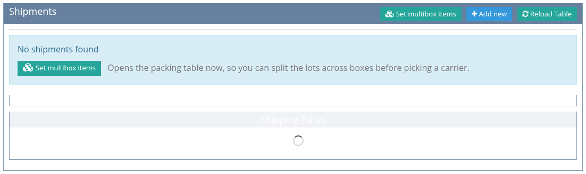
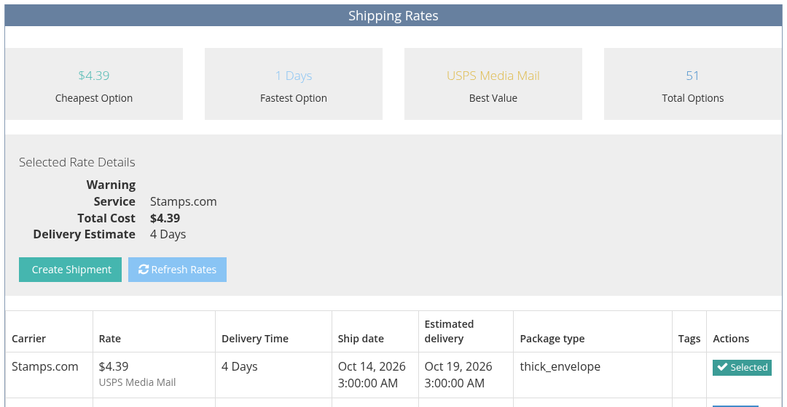
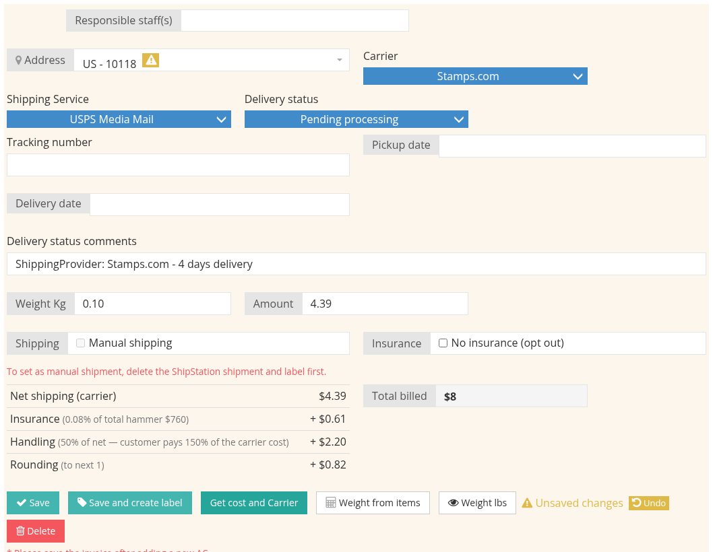

# Creating a Shipment

A shipment is created from the invoice's **Shipping & Packing** tab. Video: [Creating a shipment](tutorials/shipping.md#_1-creating-a-shipment).

## Before you start

At the top of the tab, **Shipping Preferences** shows the buyer's shipping settings from the client page, for example their carrier account or a preferred carrier and service. When the client has a preferred carrier or service, only that carrier's rates are offered.

If the invoice is above the payment approval threshold, a **Payment Approval Required** message appears and shipping is blocked until the payment is approved.

## Create the shipment

1. Open the invoice and click the **Shipping & Packing** tab.
2. In the **Shipments** block, click **Add new**. A new tab, **Shipment #New**, opens with the shipment form and the **Invoice auto packing suggestion**: how the lots would be packed and the total weight.

   

3. Check the **Address**. It defaults to the buyer's default address; pick another one of their addresses if needed.
4. Check the **Weight**. It is calculated from the lots. Click **Weight from items** to recalculate it, or **Weight lbs** to see it in pounds.
5. Click **Get cost and Carrier**. The **Shipping Rates** table lists the carrier services that can deliver the parcel, with their price and delivery estimate. The cheapest, fastest and best-value options are marked.

   

6. Click **Select** on the rate you want. The **Carrier**, **Amount** and **Total billed** fields are filled in.
7. Save:
   * **Save** creates the shipment without buying a label. You can buy it later with **Create shipping label**.
   * **Save and create label** creates the shipment and buys the carrier label in one step.

The shipment's **Total billed** is added to the invoice as a **Shipping** charge. Save the invoice after a new charge is added.

## Options on the form

| Option | What it does |
| :--- | :--- |
| **Manual shipping** | Creates the shipment without ShipStation: no rate is sent and no label is bought. Use it for parcels you send another way. You type the amount yourself. |
| **Free shipping** | Adds the shipping charge and an equal discount, so the buyer pays nothing for shipping. |
| **No insurance (opt out)** | Bills the shipment without insurance: only the shipping cost is charged. |
| **Responsible staff(s)** | The staff members in charge of this parcel. |
| **Delivery status**, **Tracking number**, **Pickup date**, **Delivery date** | Filled in automatically when a label is bought and tracking comes in; you can also set them by hand. |

## How the total is calculated

**Total billed** = carrier cost + insurance + packing and handling markup + carrier extra charges, then rounded. The buyer sees one **Shipping** line on the invoice; insurance is not shown separately. The percentages are set by an administrator, see [Shipping Settings](shipping-settings.md).

## No rates?

If the rates table says *No shipping rates available for this destination*, check that the address is complete (street, city, postal code and country) and that the weight is not zero.

See also [Labels and Tracking](labels-and-tracking.md) and [Packing](packing.md).
