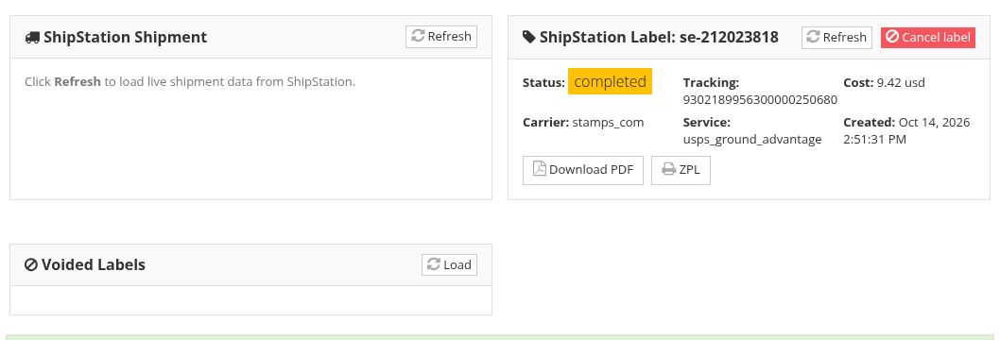

# Labels and Tracking

With the ShipStation provider, the system buys the carrier label for you and follows the parcel with the carrier's tracking. Videos: [Shipping labels](tutorials/shipping.md#_2-shipping-labels) and [Tracking and returns](tutorials/shipping.md#_6-tracking-and-returns).

## Buy the label

* When creating the shipment, click **Save and create label**, or
* on a saved shipment without a label, click **Create shipping label**.

A **ShipStation Label** panel then shows the label: its status, tracking number, cost, carrier and service. Click **Download PDF** to print it, or **ZPL** for a thermal label printer. The tracking number is also filled in on the shipment, with a **Download label PDF** link next to it.

A shipment that is "multi box" (its lots are packed in several boxes, see [Packing](packing.md)) is sent to the carrier as one package per box, so each box gets its own label. Pick a carrier that accepts several packages in one shipment, such as UPS or FedEx: USPS (Stamps.com) does not.

## A label locks the shipment

Once a label is bought, the parcel the carrier knows about must not change. While the label exists you cannot:

* change the weight or the amount,
* select another rate,
* move lots to another shipment or another box,
* add another invoice's lots to the shipment.

To change any of these, first click **Cancel label** in the **ShipStation Label** panel and confirm. The label is voided with the carrier and the shipment unlocks. Make your changes, then get the rates again and buy a new label.

Voided labels are kept on record: click **Load** in the **Voided Labels** panel to list them.

## Update the shipment

If you change the address or the weight of a shipment that was already sent to ShipStation (before buying a label), click **Update Shipment** to send the change.

## Tracking and delivery status

Once the carrier has the parcel, tracking updates arrive automatically and fill in:

* the **Delivery status** (for example *Out of the door*, then *Received*),
* the **Pickup date** and the **Delivery date** (the real arrival date),
* the carrier's estimated delivery date and any carrier messages in **Delivery status comments**.

Click **Refresh tracking** to fetch the latest tracking now.

A parcel that is past its expected delivery date and has not arrived is marked as overdue on the [Shipments page](shipments-page.md), and can raise a task (see [Shipping Settings](shipping-settings.md)).

## Return labels

When the buyer sends lots back, create a return label from the original shipment:

1. In the shipment's packing table, tick the lots that come back (the checkbox at the start of each row).
2. Type the **RMA number** if you have one.
3. Click **Create return label**.

A return shipment is created for those lots, with its own carrier label. It is listed on the original shipment with its RMA number: download the label there and send it to the buyer. Return labels depend on the carrier: not every carrier accepts them.

See also [Creating a Shipment](create-a-shipment.md) and [The Shipments Page](shipments-page.md).
