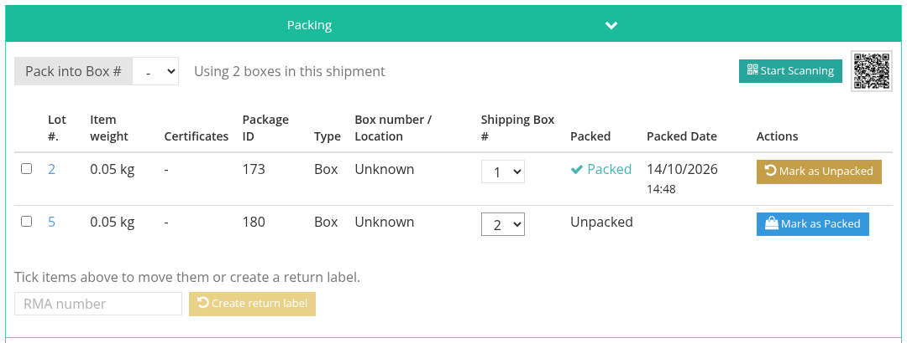
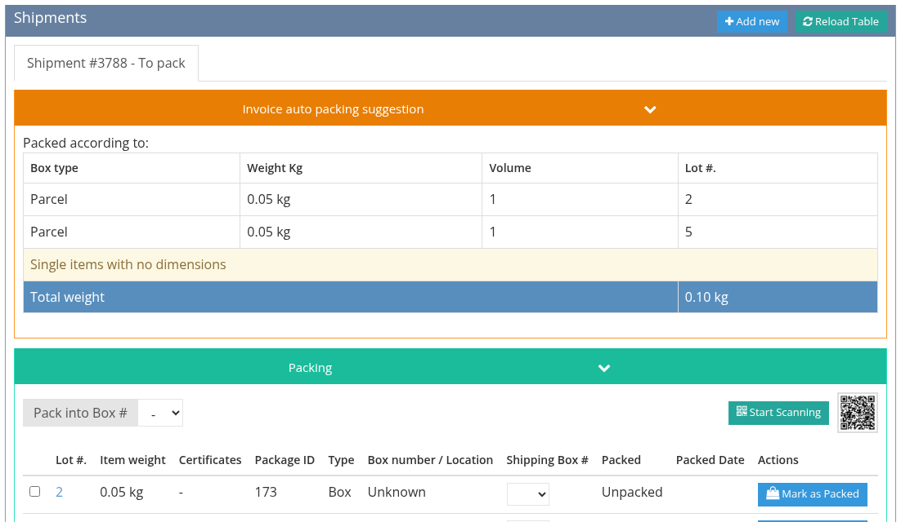

# Packing

Each shipment has a packing table listing its lots. Packing records which lot went into which box, and moves the shipment's delivery status along. Videos: [Packing](tutorials/shipping.md#_3-packing) and [Pack first, price later](tutorials/shipping.md#_4-pack-first-price-later).

## The packing table

Under the shipment form, the packing table shows one row per lot or package, with the **Lot #**, the item weight, the **Package ID**, the **Box number / Location** where the lot is stored, the **Shipping Box #** it is packed in, and whether it is **Packed** and when.

Lots that are **Under extension** (the buyer asked for an expert opinion that has not come back yet) are marked with an hourglass. They cannot be packed, and their parcel cannot get a label, until the extension is answered. You can still go ahead through a confirmation dialog; the override is recorded on the invoice.

## Pack the lots

Packing is possible while the shipment's **Delivery status** is **To pack** (or **Packed**). Set it to **To pack** on the shipment form and save, then for each lot click **Mark as Packed** (or **Create Package & Pack** when the lot has no package yet). Click **Mark as Unpacked** to undo.

* When the last lot is packed, the shipment turns to **Packed** by itself.
* Unpacking a lot puts the shipment back to **To pack**.

## Scan instead of clicking

Click **Start Scanning** to pack by scanning the lots' barcodes, or scan the QR code next to it with your phone to open this shipment on the phone and scan there. Click **Stop Scanning** when done.

## Several boxes

To pack the lots into several boxes, pick the box number in the **Shipping Box #** column for each lot (or pick a box in **Pack into Box #** before packing). The table shows how many boxes are in use (*Using 2 boxes in this shipment*), and the shipment form shows **This is a multi box shipment**. Each box is sent to the carrier as its own package, so choose a carrier that accepts several packages in one shipment, such as UPS or FedEx. USPS (Stamps.com) does not.

### Pack before choosing a carrier

You often know how the lots fit in boxes before you know what the carrier will charge. On an invoice with no shipment yet, click **Set multibox items**: the packing table opens straight away with no carrier chosen. Assign the boxes, then click **Get cost and Carrier** to get prices for the real boxes.

Packing a lot on an invoice that has no shipment yet also creates a draft shipment for you, already set to **To pack**.

See also [Creating a Shipment](create-a-shipment.md) and [Combined and Split Shipments](combined-and-split-shipments.md).
