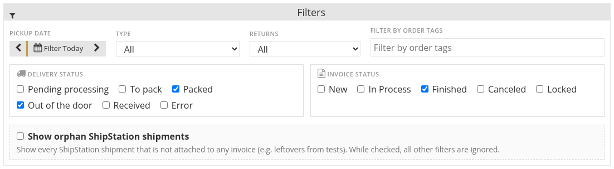
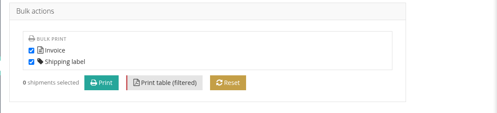
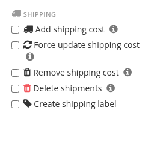

# The Shipments Page

The **Shipments** page (main menu) lists the shipments of all invoices, with their carrier, label, tracking and delivery status. Video: [The Shipments page](tutorials/shipping.md#_7-the-shipments-page).

## Filter

Filter the table by **Delivery status**, **Invoice status**, **Type**, order tags, weight range and **Pickup date** (with **Filter Today** and the arrows to move one day back or forward). The **Returns** filter shows only return labels, or excludes them. **Reset** clears the filters.

**Show orphan ShipStation shipments** lists shipments that exist in ShipStation but are not attached to any invoice, for example leftovers from tests.

A shipment past its expected delivery date that has not arrived is marked as overdue.

## Print

* **Print table (filtered)** prints the list as it is filtered.
* Select shipments and use **Bulk actions → Bulk print** to print their labels together.
* Each row links to its invoice and to its label PDF.

## Bulk shipping from the invoices list

On the bidder invoices list you can work on the shipping of many invoices at once. Tick the invoices, open **Bulk actions**, and in the **Shipping** box choose:

| Action | What it does |
| :--- | :--- |
| **Add shipping cost** | Creates a shipment and adds the shipping charge to each invoice. |
| **Force update shipping cost** | Recalculates the shipping cost and overwrites the existing charge. |
| **Remove shipping cost** | Removes the shipping charge from the invoice; the shipment is kept. |
| **Delete shipments** | Deletes every shipment of the invoice: voids the carrier labels and detaches the lots. |
| **Create shipping label** | Buys the carrier label of each invoice's shipment. |

Large batches run in the background. Invoices with lots under extension are skipped and tagged.

See also [Labels and Tracking](labels-and-tracking.md).
