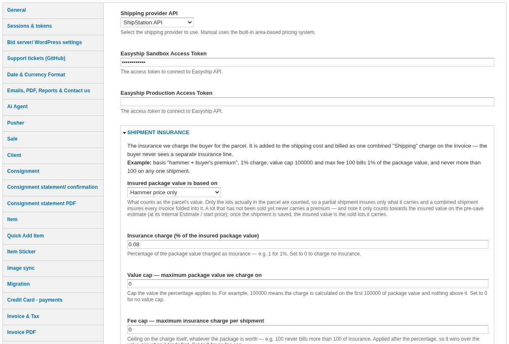

# Shipping Settings

*For administrators.* Shipping is configured in the Drupal admin under **Server settings → Shipping** (`admin/circuit-backoffice/server-settings`).

## Provider

**Shipping provider API** selects where prices and labels come from:

* **ShipStation**: live carrier rates and labels. Enter the **ShipStation Sandbox API key** for test sites and the **ShipStation Production API key** for the live site.
* **ShipStation V2**: the newer ShipStation API. It has no sandbox, so every key buys real labels; leave the non-live key empty on test sites.
* **Manual**: prices come from your own tariff tables per area and weight; no labels.
* **Easyship**.

The **Sender address** (company name, origin address and contact) is the ship-from address printed on labels. **Tax identifier type** and **Tax entity type** are sent with international shipments.

For tracking updates, set a **Webhook secret** and register the **Webhook URL** shown on the page in the ShipStation dashboard (Webhooks → TRACK event).

## What the buyer is billed

| Setting | Effect |
| :--- | :--- |
| **Insured package value is based on** | The hammer price only, or hammer plus buyer's premium. |
| **Insurance charge (%)** | Percentage of the insured value charged as insurance. 0 = no insurance. |
| **Value cap** | Maximum package value the percentage applies to. 0 = no cap. |
| **Fee cap** | Maximum insurance charge per shipment. 0 = no cap. |
| **Packing and handling markup (%)** | Added on top of the carrier cost: 50 bills the buyer 150% of the carrier cost. |

The caps apply per shipment. Insurance and markup are not shown separately to the buyer: they are part of the **Shipping** charge. Declaring a value to the carrier (so the carrier insures the parcel) is a separate checkbox and does not change what the buyer pays.

## Other settings

* **Send one package per packed box to the carrier**: on by default; turn off for carriers that do not accept multi-piece shipments.
* **Overdue shipment alerts**: a daily check raises a task for each shipment past its expected delivery date. The expected date is the carrier's estimate, or the pickup date plus the **Delivery SLA (days after pickup)**. Leave the **Task assignee UID** blank the first time you enable it, check the tasks created, then set it.
* **Payment Approval**: invoices above the threshold (non-VIP clients) need a payment approval before they can be shipped.

## Client preferences

On the client page, the buyer's **Preferred Shipping Method** and **Preferred Shipping Service** limit the rates offered to that carrier and service. **Free shipping** makes new shipments free for that client by default, and **Disable Automatic Carrier Selection** stops the system choosing a carrier for them.
